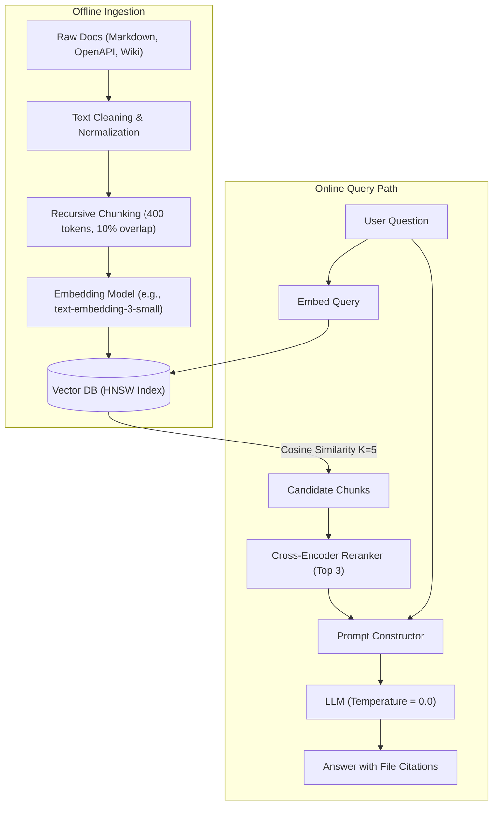

# Retrieval-Augmented Generation: Architecture, Mechanics, and Failure Modes

A practical breakdown of how RAG systems work under the hood, key engineering trade-offs, and where production pipelines break down.

---

## The Problem: Why Fine-Tuning or Prompt Stuffing Fails

When building developer assistants or documentation search over private codebases and internal wikis, engineers usually test two initial approaches before landing on RAG:

1. **Stuffing everything into the context window**: Modern models have context windows ranging from 128k to 1M tokens. However, passing an entire 200-page manual on every request creates two problems:
   - **Cost and Latency**: At scale, sending 80,000 tokens per request is expensive and pushes time-to-first-token (TTFT) past 3 to 4 seconds.
   - **The "Lost in the Middle" problem**: Benchmarks consistently show that LLMs retrieve facts from the beginning and end of long prompts much more reliably than from the middle 60%.
2. **Fine-Tuning the model on private documents**: Fine-tuning is effective for adjusting style, tone, or domain syntax (e.g., generating code in an internal framework). It is poor at teaching factual recall. Updating documentation requires re-training or running another fine-tuning run, which is impractical for living docs updated weekly.

**Retrieval-Augmented Generation (RAG)** splits the problem into two distinct engineering components: a deterministic retrieval system (fetching exact text snippets) and a probabilistic language model (synthesizing the final answer from those snippets).

---

## End-to-End System Architecture

A standard RAG pipeline operates across two lifecycles: an offline ingestion path and a real-time query path.



---

## Detailed Pipeline Breakdown

### 1. Document Parsing and Chunking

Raw markdown and HTML cannot be fed directly to embedding models in bulk. The text must be split into chunks small enough to maintain semantic specificity, but large enough to retain context.

#### The Chunk Size Dilemma

- **Small chunks (100 - 200 tokens)**: Very precise vector representations. If a user asks *"what port does the daemon listen on?"*, the chunk containing `PORT=8443` will score near 0.95 similarity. However, surrounding context (e.g., whether this applies to staging or production) is lost.
- **Large chunks (800 - 1500 tokens)**: Retains broader context and narrative flow. However, the vector embedding becomes an average of multiple topics, diluting the specific operational facts.

#### Practical Engineering Recommendation
For technical manuals and API documentation, start with **400 to 500 tokens** using a **recursive character text splitter** that prioritizes splitting on markdown headers (`##`, `###`), then paragraph breaks (`\n\n`), then sentences. Maintain a **10% to 15% overlap** (40 to 60 tokens) between consecutive chunks so boundary sentences are not cut mid-explanation.

```
[--- Chunk 1 (Tokens 0 - 500) ---]
                         [--- Chunk 2 (Tokens 450 - 950) ---]
                                                  [--- Chunk 3 (Tokens 900 - 1400) ---]
                         ▲                        ▲
                   Overlap (50t)            Overlap (50t)
```

### 2. Vector Indexing and Distance Calculations

Once chunks are generated, they pass through an embedding model that outputs dense floating-point vectors (typically 768 or 1536 dimensions).

In production, these vectors are stored in an index using **HNSW (Hierarchical Navigable Small World)** graphs rather than doing brute-force flat searches. HNSW constructs a multi-layer graph where greedy search achieves sub-10ms query times over hundreds of thousands of vectors at the cost of modest memory overhead during index construction.

### 3. The Retrieval Bottleneck: Pure Vector vs. Hybrid Search

Pure vector search matches semantics, but frequently fails on exact strings common in engineering docs:
- Error codes: `ERR_STORAGE_LOCK_TIMEOUT`
- CLI flags: `--preserve-permissions=true`
- Version tags: `v2.4.1-rc3`

An embedding model might treat `v2.4.1` and `v2.4.2` as 99% identical because they mean the same thing conceptually, even though an engineer debugging an issue needs information specific to that exact patch release.

**Solution**: Use a **hybrid search** combining BM25 (sparse keyword frequency) and dense vector search, merged using Reciprocal Rank Fusion (RRF):

```
RRF Score = (1 / (60 + BM25_Rank)) + (1 / (60 + Vector_Rank))
```

This ensures that exact keyword matches remain at the top of the retrieved set while semantic matches fill in conceptual gaps.

### 4. Generation and Grounding Guardrails

The final prompt passed to the LLM must enforce strict boundaries. Without explicit negative constraints, language models default to answering based on parametric memory when retrieved context is thin.

Example of a production-tested prompt template:

```text
You are a technical support documentation assistant.
Answer the user query based ONLY on the following context snippets.
If the context does not contain enough information to resolve the question,
state clearly: "I cannot find this information in the documentation."
Do not attempt to infer or extrapolate beyond the text.

Context:
[Doc: storage_admin.md | Chunk 14]
Retention policies set on immutable backups cannot be shortened or deleted
by any user account until the timer expires.

[Doc: networking.md | Chunk 3]
Data replication operates on port 9092 using TLS 1.3 encryption.

Question:
Can a root admin reduce the retention window on an immutable backup?
```

Setting `temperature=0.0` ensures deterministic, repeatable outputs.

---

## Production Failure Modes and How to Fix Them

| Failure Mode | Root Cause | Engineering Fix |
| :--- | :--- | :--- |
| **Model hallucinates a plausible answer** | Context was irrelevant or empty, but prompt lacked refusal instructions. | Add explicit fallback instructions ("If missing, output X") and evaluate with a faithfulness benchmark. |
| **Correct chunk exists, but was ranked #12 and missed top-5 cutoff** | Vector similarity scored lower due to vocabulary mismatch. | Add a cross-encoder reranker (e.g., Cohere Rerank or BGE-Reranker) over top-20 candidates before passing top-5 to the LLM. |
| **Model answers question for wrong environment (Staging vs. Production)** | Metadata was stripped during ingestion; chunks looked identical. | Prepend chunk content with parent metadata: `Env: Production | Section: Cluster Init`. |
| **High latency (P95 > 3.5s)** | Embedding API calls or unoptimized vector queries blocking the main loop. | Cache common query embeddings via Redis; switch from API embeddings to a quantized local model on GPU/ONNX. |

---

## Summary

RAG is fundamentally a data engineering problem rather than an LLM prompt problem. Improving RAG performance usually comes from cleaning markdown, tuning chunk boundaries, and adding metadata filters—not from changing prompt adjectives.

*Authored by Vivek as part of the [Technical Writing Portfolio](https://github.com/vivek12x/technical-writing-portfolio).*
