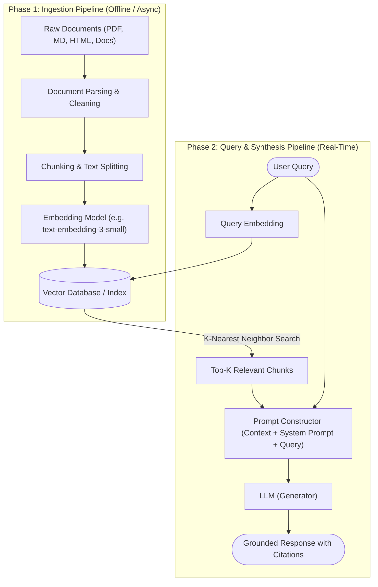

# Understanding Retrieval-Augmented Generation (RAG)

> **A deep dive into the architecture, mechanics, and trade-offs of grounding Large Language Models on enterprise and external knowledge.**

---

## 1. Executive Summary

Large Language Models (LLMs) such as GPT-4, Claude, and Gemini demonstrate remarkable fluency and general reasoning abilities. However, when deployed in enterprise and technical environments, out-of-the-box LLMs face two critical limitations:

1. **Static Parametric Knowledge**: An LLM’s internal memory freezes at its training cutoff date. It knows nothing about events, documents, or data created after that window.
2. **Hallucination Risk**: When prompted with queries beyond their training domain, LLMs do not report a lack of data; instead, they probabilistically generate plausible-sounding yet factually fabricated responses.

**Retrieval-Augmented Generation (RAG)** solves both challenges by combining the dynamic information retrieval capabilities of search systems with the generative synthesis of language models. Rather than relying on memorization, the model is provided with authoritative, up-to-date reference text retrieved in real time.

---

## 2. The Mental Model: The Open-Book Exam Analogy

To understand RAG intuitively, consider two students taking an advanced engineering certification:

```
┌────────────────────────────────────────────────────────┐
│                   Parametric Only                      │
│               (Standard LLM Inference)                 │
│                                                        │
│  Student sits in an empty room with no reference text. │
│  They rely entirely on memorization. When memory fails │
│  or becomes vague, they fabricate details that sound   │
│  grammatically and conceptually convincing.            │
└────────────────────────────────────────────────────────┘

                           vs.

┌────────────────────────────────────────────────────────┐
│             Retrieval-Augmented Generation             │
│                     (RAG System)                       │
│                                                        │
│  Student sits in an open-book exam.                    │
│  When a question is posed, an assistant instantly      │
│  locates the exact 3 pages from the textbook. The      │
│  student synthesizes an answer directly cited from     │
│  those verified pages.                                 │
└────────────────────────────────────────────────────────┘
```

RAG turns the LLM from an ungrounded generator into an attentive, context-aware analyst.

---

## 3. The End-to-End RAG Architecture

A production-grade RAG pipeline consists of two distinct lifecycle phases: the **Offline Ingestion Phase** and the **Online Query Phase**.



---

## 4. Architectural Deep Dive: The 5 Core Stages

### Stage 1: Document Ingestion and Cleaning
Raw enterprise data is messy. It arrives as unstructured PDFs, scanned images, Confluence pages, markdown files, and relational database records.
- **Parsing**: Strips away boilerplate (headers, footers, navigation bars, CSS) while preserving semantic markup (tables, headings, code blocks).
- **Metadata Tagging**: Each document is tagged with contextual metadata (document ID, section title, timestamps, access control lists). This metadata proves invaluable later for hybrid filtering.

### Stage 2: Chunking Strategies
LLMs have finite context windows, and embedding models perform poorly when attempting to capture the semantic nuance of an entire 100-page document into a single vector. Documents must therefore be segmented into smaller units called **chunks**.

Selecting the appropriate chunking strategy directly determines retrieval accuracy:

| Chunking Strategy | Mechanism | Best Used For | Trade-offs |
| :--- | :--- | :--- | :--- |
| **Fixed-Size Chunking** | Splits text every $N$ tokens with a constant overlap (e.g., 500 tokens with 50-token overlap). | General documentation, homogenous text corpora. | High speed, but risks severing sentences and splitting conceptual ideas mid-thought. |
| **Recursive Character Splitting** | Attempts splits hierarchically (`\n\n`, then `\n`, then ` `) to keep paragraphs intact. | Technical guides, blogs, multi-section manuals. | Preserves paragraph context, but chunk sizes vary somewhat. |
| **Semantic Chunking** | Computes embedding similarity across consecutive sentences; splits where semantic distance spikes. | Analytical essays, legal contracts, research papers. | High semantic integrity; computationally expensive at ingestion. |

> [!TIP]
> **The Chunk Overlap Rule of Thumb**: Always maintain a 10% to 15% overlap between adjacent chunks. This guarantees that concepts spanning across a chunk boundary do not lose their semantic coherence.

### Stage 3: Embedding Generation & Indexing
Each chunk is passed through an embedding model (e.g., `text-embedding-3-large`, `all-MiniLM-L6-v2`) which maps textual meaning into a high-dimensional vector space (typically 768 to 3072 dimensions).
- In this vector space, documents with similar semantic meanings reside near one another, regardless of whether they share exact vocabulary.
- The vectors are indexed into specialized storage engines (e.g., Pinecone, Milvus, Qdrant, pgvector) using algorithms like **Hierarchical Navigable Small World (HNSW)** to enable sub-millisecond approximate nearest neighbor (ANN) searches.

### Stage 4: Query Retrieval & Re-Ranking
When a user asks a question:
1. The user's query is converted into a vector using the same embedding model.
2. The vector index computes distance metrics (Cosine Similarity or Dot Product) to retrieve the top $K$ closest candidate chunks.
3. **Re-Ranking (Optional but Recommended)**: A cross-encoder model re-evaluates the retrieved candidates against the raw text of the query, scoring each chunk for direct relevance. This eliminates false positives where vectors appear close geometrically but fail to answer the specific query intent.

### Stage 5: Context Assembly & Grounded Generation
The final step assembles the prompt payload sent to the LLM. A standard enterprise prompt template looks like this:

```markdown
SYSTEM:
You are an expert technical support assistant. Your task is to answer the user's question
STRICTLY using the provided CONTEXT below.
- If the answer cannot be determined from the context, state: "I do not have sufficient information to answer this based on the available documentation."
- Do not speculate or use outside knowledge.
- Cite the source document ID for each claim.

CONTEXT:
---
[Source: doc-storage-v2.md | ID: #304]
Enterprise backup systems provide snapshot-based immutability using DataLock policies. Once an immutability retention
period is set on a View or Snapshot, it cannot be reduced or deleted, even by a super-admin.
---
[Source: doc-storage-v2.md | ID: #305]
Replication policies can run concurrently with local backup schedules without locking the volume.
---

USER QUESTION:
Can an administrator manually delete a snapshot protected with DataLock?

ASSISTANT:
```

The LLM then reads the augmented context and generates a precise, attributed response.

---

## 5. Key Engineering Trade-Offs

Implementing RAG is rarely a matter of picking default parameters. Production systems require navigating trade-offs:

```
High Chunk Size (1000+ tokens)             Low Chunk Size (150-250 tokens)
┌────────────────────────────────┐         ┌────────────────────────────────┐
│ + Rich surrounding context     │         │ + Laser-focused retrieval      │
│ - Dilutes specific facts       │   vs.   │ - Loses broad context          │
│ - Hits context token limits    │         │ - Requires stitching fragments │
└────────────────────────────────┘         └────────────────────────────────┘
```

1. **Precision vs. Recall**:
   - Retrieving too few chunks ($K=2$) risks missing critical supporting data (low recall).
   - Retrieving too many chunks ($K=20$) increases inference latency, elevates LLM token costs, and introduces distraction noise that can cause the model to miss the needle in the haystack (low precision).

2. **Vector Search vs. Hybrid Search**:
   - Pure vector search excels at conceptual matching ("how do I safeguard data against ransomware?").
   - Pure vector search often fails at exact keyword queries ("Error Code 0x80040154" or product part numbers).
   - **Modern Standard**: Combine dense vector retrieval with sparse keyword search (BM25) using Reciprocal Rank Fusion (RRF).

---

## 6. Summary Checklist for RAG Practitioners

When designing or evaluating a documentation RAG system, verify the following:

- [x] **Document Cleanliness**: Are headers, navigation, and boilerplate stripped before embedding?
- [x] **Chunking Sizing**: Is the chunk size calibrated to the granularity of typical user questions?
- [x] **Metadata Preservation**: Are URLs, titles, and version numbers attached to chunks for citation?
- [x] **Prompt Guardrails**: Does the system prompt explicitly mandate refusal when context is missing?
- [x] **Evaluation Loop**: Are retrieval recall and generation faithfulness systematically tracked?

---

*Authored by Vivek as part of the [Technical Writing Portfolio](https://github.com/vivek12x/technical-writing-portfolio).*
